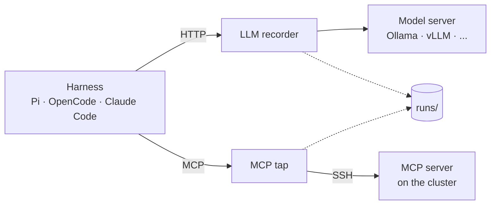

# void-agents

Run open AI coding agents on HPC clusters, record everything they do, and model their
performance. Every part is replaceable: the harness (Pi, OpenCode, Claude Code, ...), the model
(any OpenAI-compatible endpoint), the MCP server and the cluster.

## How the parts connect



The agent reaches the cluster only through MCP, and both recorders write every message into the
run folder. Each box can be swapped by configuration: another harness, model, MCP server or
cluster.

## Quick start

Needs [uv](https://docs.astral.sh/uv/), a model server (e.g. Ollama with `qwen3.5:4b`) and at least
one harness (`pi`, `claude`, `opencode`). No cluster is needed: the default cluster profile `local`
runs the MCP server on your machine.

```bash
./void pi                                   # new session in a new sandbox (normal Pi interface)
./void pi --continue [RUN]                  # continue a session (default: your latest Pi run)
./void pi --sandbox NAME                    # new session in a named sandbox (created if missing)
./void pi --dir ~/projects/stencil          # new session working directly in a folder you choose
./void pi --task hello-edit --reps 3        # headless runs, each checked by the task
./void pi --prompt "TEXT" [--continue]      # one headless message
./void --from runs/<date>/<run>             # repeat a headless run with the same inputs
./void claude ... / ./void opencode ...     # the same for the other harnesses
```

Options: `--model` (profile in `config/models/`, default `ollama-qwen3.5-4b`), `--cluster` (profile in
`config/clusters/`, default `local`), `--timeout` for headless runs. Every start through `./void`
creates a run folder; plain `pi` or `claude` are not recorded.

For a real cluster: `./deploy.sh <ssh-host>`, then copy `config/clusters/nhr-testcluster.example.toml`
to `<name>.local.toml` (gitignored), fill in your values and pass `--cluster <name>`.

## Layout

| Path | Contents |
|---|---|
| `AGENTS.md` | Rules for any agent and any MCP server, loaded into every session |
| `skills/hpc-cluster/` | Cluster knowledge (Slurm job scripts, file systems, proxy), loaded on demand |
| `mcp_server/` | Our MCP server: sandboxed `list_dir`, `read_file`, `write_file`, `edit_file`; tests (`uv run pytest`) |
| `record/` | The recorders: `llm_proxy.py` (model traffic) and `mcp_tap.py` (MCP traffic); tests |
| `deploy.sh` | `./deploy.sh <ssh-host>` installs or updates the server on a cluster and prints its start command |
| `void`, `run.py` | The launcher: prepares sandbox and config, starts recorders and harness, writes the run folder |
| `harnesses.py` | One function per harness (Pi, Claude Code, OpenCode): its config and start command |
| `config/` | Model and cluster profiles (`*.local.toml` are personal and gitignored) |
| `tasks/` | Headless tasks: `prompt.md`, start `files/`, `check.py` |
| `reference/nhr/` | Unchanged NHR@FAU originals, downloaded 2026-11-06 from `https://doc.nhr.fau.de/apps/AGENTS.md.txt` and `.../SKILL.md.txt` |

## Runs

Each run is stored as (`_<task>_r<rep>` only for task runs)

```
runs/<YYYY-MM-DD>/<HH-MM-SS>_<harness>_<model>_<task>_r<rep>/
  manifest.json   mode (new | continue | reuse-sandbox), continued run, sandbox, all inputs, exact
                  commands, harness version, model digest and context length, warnings, git commit,
                  host, start/end, exit code
  config/         harness config generated for this run, incl. instructions.md (AGENTS.md + skill)
  session/        the harness's own conversation state; copied into the next run on --continue
  llm.jsonl       every model request and response, with timings
  mcp.jsonl       every MCP message, with timings
  mcp.stderr.log  the MCP server's stderr
  harness/        headless runs: the harness's event stream and stderr
  sandbox/        snapshot of the sandbox files at the end of the run
  result.json     task runs: check result
```

Sessions and sandboxes are separate: `--continue` keeps both, `--sandbox NAME` keeps the files but
starts a new conversation. Earlier run folders are never changed.

`--dir PATH` lets the agent work directly in an existing folder (on the cluster for remote profiles).
The agent can change files there, so use git or a copy. Refused: `/`, your home folder or anything
containing it, and this repo (the agent could rewrite its own recordings). Snapshots skip `.git`,
`.venv`, `node_modules` and `__pycache__`, and are skipped with a warning above 100 MB.

The files are the source of truth and can be queried directly, e.g. with DuckDB:
`select * from read_json('runs/*/*/llm.jsonl')`. `runs/` is gitignored and stays local; one example
run is committed: `runs/2026-11-06/17-37-42_pi_ollama-qwen3.5-4b_hello-edit_r1/`.

### Record formats

Both recorders store raw data with Unix timestamps (seconds) from the same clock, so the two files
merge into one timeline. Tokens, turns and tool time are derived later from the raw data.

| File | One line per | Fields |
|---|---|---|
| `llm.jsonl` | HTTP request to the model | `t_start`, `t_first_byte`, `t_end`, `method`, `path`, `query`, `status`, `request_headers` (secrets removed), `request` (JSON body), `response` (raw text, incl. streamed chunks), `error` if any |
| `mcp.jsonl` | JSON-RPC message | `t`, `dir` (`to_server` or `to_client`), `msg` (the message as sent) |

Recorders are started by hand like this (step 3's `run.py` will do it):

```bash
uv run python record/llm_proxy.py --upstream http://127.0.0.1:11434 --port 8400 --log <run>/llm.jsonl
uv run python record/mcp_tap.py --log <run>/mcp.jsonl -- <MCP server command ...>
```
