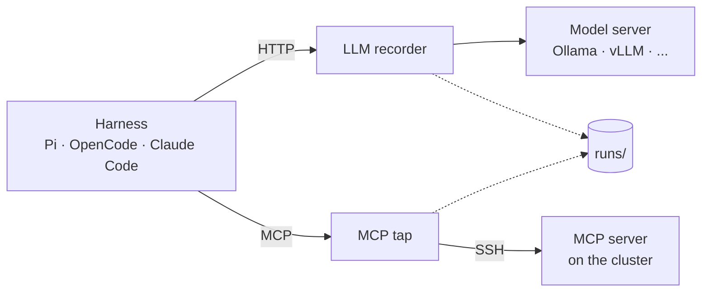

# void-agents

Run open AI coding agents on HPC clusters, record everything they do, and model their
performance. Every part is replaceable: the harness (Pi, OpenCode, Claude Code, ...), the model
(any OpenAI-compatible endpoint), the MCP server and the cluster.

## How the parts connect



The agent reaches the cluster only through MCP, and both recorders write every message into the
run folder. Each box can be swapped by configuration: another harness, model, MCP server or
cluster.

## Layout

| Path | Contents |
|---|---|
| `AGENTS.md` | Rules for any agent and any MCP server, loaded into every session |
| `skills/hpc-cluster/` | Cluster knowledge (Slurm job scripts, file systems, proxy), loaded on demand |
| `mcp_server/` | Our MCP server: sandboxed `list_dir`, `read_file`, `write_file`, `edit_file`; tests (`uv run pytest`) |
| `deploy.sh` | `./deploy.sh <ssh-host>` installs or updates the server on a cluster and prints its start command |
| `reference/nhr/` | Unchanged NHR@FAU originals, downloaded 2026-11-06 from `https://doc.nhr.fau.de/apps/AGENTS.md.txt` and `.../SKILL.md.txt` |

## Runs

Each run is stored as

```
runs/<YYYY-MM-DD>/<HH-MM-SS>_<harness>_<model>_<task>_r<rep>/
  manifest.json   exact command, profile snapshots, versions, model digest, sampling, host, repo commit
  config/         harness config generated for this run
  llm.jsonl       every model request and response, with tokens and timings
  mcp.jsonl       every MCP message, with timings
  harness/        the harness's own session log
  result.json     task check: pass/fail and metrics
```

The files are the source of truth and can be queried directly, e.g. with DuckDB:
`select * from read_json('runs/*/*/llm.jsonl')`.
