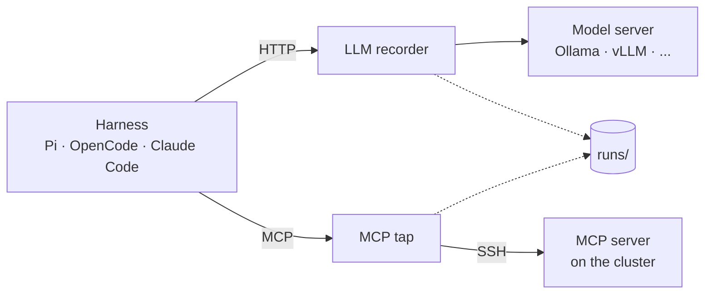

# void-agents

Run open AI coding agents on HPC clusters, record everything they do, and model their
performance. Every part is replaceable: the harness (Pi, OpenCode, Claude Code, ...), the model
(any OpenAI-compatible endpoint), the MCP server and the cluster.

## How the parts connect



The agent reaches the cluster only through MCP, and both recorders write every message into the
run folder. Each box can be swapped by configuration: another harness, model, MCP server or
cluster.

## Layout

| Path | Contents |
|---|---|
| `AGENTS.md` | Rules for any agent and any MCP server, loaded into every session |
| `skills/hpc-cluster/` | Cluster knowledge (Slurm job scripts, file systems, proxy), loaded on demand |
| `mcp_server/` | Our MCP server: sandboxed `list_dir`, `read_file`, `write_file`, `edit_file`; tests (`uv run pytest`) |
| `record/` | The recorders: `llm_proxy.py` (model traffic) and `mcp_tap.py` (MCP traffic); tests |
| `deploy.sh` | `./deploy.sh <ssh-host>` installs or updates the server on a cluster and prints its start command |
| `reference/nhr/` | Unchanged NHR@FAU originals, downloaded 2026-11-06 from `https://doc.nhr.fau.de/apps/AGENTS.md.txt` and `.../SKILL.md.txt` |

## Runs

Each run is stored as

```
runs/<YYYY-MM-DD>/<HH-MM-SS>_<harness>_<model>_<task>_r<rep>/
  manifest.json   exact command, profile snapshots, versions, model digest, sampling, host, repo commit
  config/         harness config generated for this run
  llm.jsonl       every model request and response, with timings
  mcp.jsonl       every MCP message, with timings
  mcp.stderr.log  the MCP server's stderr
  harness/        the harness's own session log
  result.json     task check: pass/fail and metrics
```

The files are the source of truth and can be queried directly, e.g. with DuckDB:
`select * from read_json('runs/*/*/llm.jsonl')`. Small runs are committed to git for now; where
large runs go is decided when they exist.

### Record formats

Both recorders store raw data with Unix timestamps (seconds) from the same clock, so the two files
merge into one timeline. Tokens, turns and tool time are derived later from the raw data.

| File | One line per | Fields |
|---|---|---|
| `llm.jsonl` | HTTP request to the model | `t_start`, `t_first_byte`, `t_end`, `method`, `path`, `query`, `status`, `request_headers` (secrets removed), `request` (JSON body), `response` (raw text, incl. streamed chunks), `error` if any |
| `mcp.jsonl` | JSON-RPC message | `t`, `dir` (`to_server` or `to_client`), `msg` (the message as sent) |

Recorders are started by hand like this (step 3's `run.py` will do it):

```bash
uv run python record/llm_proxy.py --upstream http://127.0.0.1:11434 --port 8400 --log <run>/llm.jsonl
uv run python record/mcp_tap.py --log <run>/mcp.jsonl -- <MCP server command ...>
```
